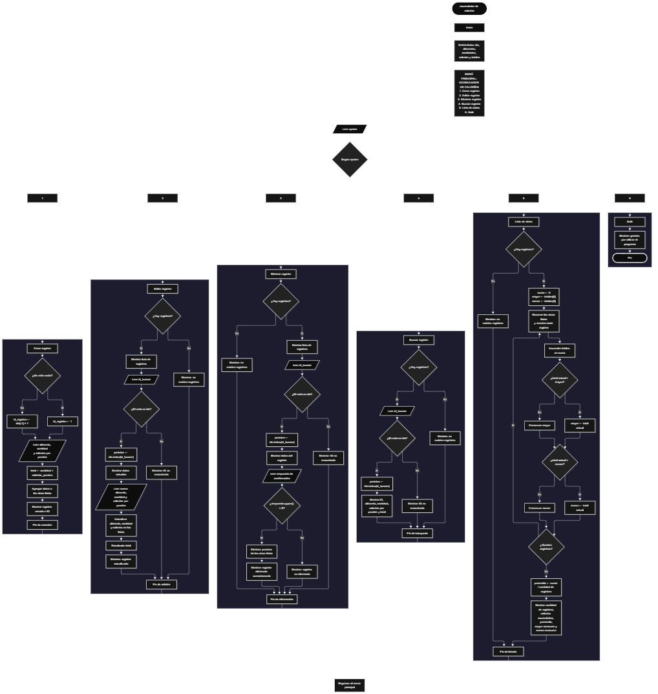

 

Este proyecto, llamado <b>acumulador de calorías</b>, fue desarrollado en <b>python</b> como un ejercicio práctico para fortalecer la lógica de programación mediante la creación de un sistema de registro y seguimiento de calorías consumidas desde la consola. El programa cuenta con un menú principal de seis opciones que permite <b>crear, editar, eliminar, buscar y listar registros de alimentos</b>, además de finalizar la ejecución del programa. Cada registro almacena información como el identificador, el nombre del alimento, la cantidad consumida, las calorías por porción y el total de calorías calculado. Para organizar los datos, se utilizan cinco listas paralelas que mantienen la información de cada registro en posiciones correspondientes durante la ejecución. El programa también incorpora estadísticas que permiten conocer la cantidad de registros almacenados, las calorías acumuladas, el promedio de calorías por registro, el mayor consumo y el menor consumo. Durante su desarrollo se aplicaron conceptos fundamentales de programación, como variables, listas, estructuras condicionales, ciclos repetitivos, métodos de listas, operaciones aritméticas y búsqueda mediante identificadores. Este proyecto permite poner en práctica los conocimientos adquiridos en python y sirve como base para desarrollar sistemas de seguimiento nutricional más avanzados.

<h2 align="center">⚙️ Funcionamiento del menú principal</h2>

### ➕ Crear registro

La opción <b>1) crear registro</b> permite registrar un nuevo alimento en el acumulador de calorías. Primero, el programa determina el identificador que se asignará al registro mediante la condición <b>len(ids) == 0</b>. Si la lista está vacía, el identificador comienza en <b>1</b>; de lo contrario, se obtiene sumando uno al último identificador almacenado mediante <b>ids[-1] + 1</b>. Después, el programa solicita el <b>nombre del alimento, la cantidad consumida y las calorías por porción</b>. Los valores de cantidad y calorías se convierten a números enteros utilizando <b>int()</b>. A continuación, calcula el total de calorías mediante la operación <b>cantidad * calorias_porcion</b>. Los datos se almacenan en las listas <b>ids, alimentos, cantidades, calorias y totales</b> utilizando el método <b>append()</b>, conservando la correspondencia entre las posiciones. Finalmente, muestra el mensaje <b>"registro creado correctamente."</b> y presenta el identificador asignado al nuevo registro.

### ✏️ Editar registro

La opción <b>2) editar registro</b> permite modificar la información de un alimento previamente registrado. Antes de comenzar, el programa comprueba si existen registros mediante la condición <b>len(ids) == 0</b>. Si no hay registros almacenados, muestra el mensaje <b>"no existen registros."</b>. En caso contrario, presenta los datos de los registros mediante un ciclo <b>for</b>, mostrando el identificador, el alimento, la cantidad, las calorías por porción y el total de calorías. Después, solicita el identificador del registro que se desea editar y comprueba si existe en la lista <b>ids</b> mediante la condición <b>id_buscar in ids</b>. Si el identificador es válido, utiliza <b>ids.index(id_buscar)</b> para obtener la posición correspondiente y muestra los datos actuales. A continuación, solicita el nuevo nombre del alimento, la nueva cantidad y las nuevas calorías por porción. Los valores se actualizan directamente en las listas correspondientes y se recalcula el total mediante <b>cantidades[posicion] * calorias[posicion]</b>. Finalmente, presenta el mensaje <b>"registro actualizado correctamente."</b>. Si el identificador no existe, muestra el mensaje <b>"id no encontrada."</b>.

### 🗑️ Eliminar registro

La opción <b>3) eliminar registro</b> permite eliminar un alimento registrado mediante su identificador. Primero, el programa comprueba si existen registros almacenados. Si las listas están vacías, muestra el mensaje <b>"no existen registros."</b>. Si hay datos disponibles, presenta una lista con los identificadores, los nombres de los alimentos, las cantidades, las calorías por porción y los totales. Después, solicita el identificador del registro que se desea eliminar y comprueba si se encuentra en la lista <b>ids</b>. Si existe, obtiene su posición mediante <b>ids.index(id_buscar)</b> y muestra los datos correspondientes. A continuación, solicita confirmación mediante la variable <b>respuesta</b>. Si el usuario introduce la letra <b>"S"</b>, el programa elimina la posición seleccionada de las cinco listas utilizando el método <b>pop(posicion)</b>. De esta manera, se mantienen sincronizados los datos del registro eliminado. Finalmente, muestra el mensaje <b>"registro eliminado correctamente."</b>. Si el usuario no confirma la operación, presenta el mensaje <b>"el registro no fue eliminado."</b>. Si el identificador no existe, muestra el mensaje <b>"id no encontrada."</b>.

### 🔎 Buscar registro

La opción <b>4) buscar registro</b> permite localizar un alimento mediante su identificador. Primero, el programa comprueba si existen registros almacenados. Si no hay datos, muestra el mensaje <b>"no existen registros."</b>. En caso contrario, solicita el identificador que se desea buscar mediante la variable <b>id_buscar</b> y verifica si está presente en la lista <b>ids</b> utilizando la condición <b>id_buscar in ids</b>. Cuando encuentra el identificador, obtiene su posición mediante <b>ids.index(id_buscar)</b> y muestra toda la información relacionada con el registro: identificador, alimento, cantidad consumida, calorías por porción y total de calorías. Si el identificador introducido no corresponde a ningún registro almacenado, presenta el mensaje <b>"id no encontrada."</b>. Esta operación facilita consultar la información de un alimento sin necesidad de recorrer manualmente todos los registros.

### 📋 Lista de datos

La opción <b>5) lista de datos</b> permite visualizar los registros almacenados y obtener estadísticas sobre las calorías consumidas. Antes de comenzar, el programa comprueba si existen registros mediante la condición <b>len(ids) == 0</b>. Si no hay datos, muestra el mensaje <b>"no existen registros."</b>. Si existen registros, inicializa la variable <b>suma</b> en cero y establece las variables <b>mayor</b> y <b>menor</b> con el primer valor de la lista <b>totales</b>. Después, utiliza un ciclo <b>for</b> para recorrer las cinco listas y mostrar la información de cada alimento en columnas organizadas mediante una cadena formateada. Durante el recorrido, acumula los totales de calorías y compara cada valor con las variables <b>mayor</b> y <b>menor</b> para determinar el consumo máximo y mínimo registrado. Una vez finalizado el recorrido, calcula el promedio mediante <b>suma / len(ids)</b> y utiliza <b>round(promedio, 2)</b> para mostrarlo con dos decimales. Finalmente, presenta la cantidad de registros, las calorías acumuladas, el promedio de calorías por registro, el mayor consumo y el menor consumo.

### 🚪 Salir del menú principal

La opción <b>6) salir</b> permite finalizar la ejecución del acumulador de calorías. Cuando el usuario selecciona esta opción, el programa muestra el mensaje <b>"gracias por utilizar el programa."</b> y ejecuta la instrucción <b>break</b>. Esta instrucción interrumpe el ciclo repetitivo <b>while True</b> que mantiene activo el menú principal, permitiendo que el programa termine correctamente. A diferencia de las demás opciones, esta operación no necesita consultar ni modificar los registros almacenados.

<h2 align="center">🧠 Temas aplicados en el proyecto</h2>

### 📦 Variables

En este proyecto se utilizan variables para controlar las opciones del menú, identificar los registros, almacenar temporalmente los datos introducidos por el usuario, localizar posiciones dentro de las listas y realizar los cálculos necesarios para obtener las calorías consumidas. También se utilizan variables auxiliares para acumular los totales y determinar las estadísticas de los registros. Cada variable cumple una función específica dentro de las operaciones de creación, edición, eliminación, búsqueda y consulta de información.

🔢 **Opcion:** Almacena la opción seleccionada por el usuario en el menú principal.

🆔 **Id_registro:** Almacena el identificador asignado al nuevo registro.

🍎 **Alimento:** Almacena el nombre del alimento que se desea registrar o actualizar.

🔢 **Cantidad:** Almacena la cantidad consumida del alimento.

🔥 **Calorias_porcion:** Almacena las calorías correspondientes a cada porción del alimento.

🧮 **Total:** Almacena el resultado de multiplicar la cantidad consumida por las calorías por porción durante la creación de un registro.

🔎 **Id_buscar:** Almacena el identificador que el usuario desea editar, eliminar o consultar.

📍 **Posicion:** Representa el índice donde se encuentra el registro seleccionado dentro de las listas.

✅ **Respuesta:** Almacena la respuesta del usuario para confirmar o cancelar la eliminación de un registro.

📊 **Suma:** Acumula los totales de calorías de todos los registros durante la generación de estadísticas.

⬆️ **Mayor:** Almacena el valor más alto de calorías totales encontrado durante el recorrido.

⬇️ **Menor:** Almacena el valor más bajo de calorías totales encontrado durante el recorrido.

📈 **Promedio:** Almacena el resultado de dividir la suma de calorías entre la cantidad de registros.

🔄 **I:** Funciona como contador en los ciclos <b>for</b> utilizados para recorrer las listas.

### 🗃️ Listas

En este proyecto se utilizan cinco listas paralelas para organizar los datos de cada alimento registrado. Todas las listas utilizan la misma posición para representar la información relacionada con un registro específico. Por ejemplo, los datos de un registro ubicado en la posición <b>0</b> se encuentran distribuidos entre <b>ids[0], alimentos[0], cantidades[0], calorias[0] y totales[0]</b>. Esta organización permite acceder a los datos de manera ordenada, actualizar sus valores, eliminar registros y generar estadísticas. Las listas se crean vacías al iniciar el programa y conservan la información únicamente durante su ejecución.

🆔 **Ids:** Almacena los identificadores de los registros creados.

🍎 **Alimentos:** Almacena los nombres de los alimentos registrados.

🔢 **Cantidades:** Almacena las cantidades consumidas de cada alimento.

🔥 **Calorias:** Almacena las calorías por porción de cada alimento.

📊 **Totales:** Almacena las calorías totales calculadas para cada registro.

### 🔀 Estructuras condicionales

En este proyecto se utilizan las estructuras <b>if, elif y else</b> para controlar las opciones del menú principal y decidir qué operación debe ejecutarse. También permiten comprobar si existen registros almacenados antes de realizar una búsqueda, edición, eliminación o consulta estadística. Mediante condiciones como <b>id_buscar in ids</b>, el programa determina si un identificador está registrado. En la opción de estadísticas, utiliza comparaciones para determinar el mayor y el menor consumo de calorías. Estas estructuras permiten que el programa responda de manera diferente según los datos disponibles y las decisiones del usuario.

### 🔄 Estructuras repetitivas

En este proyecto se utilizan los ciclos <b>while</b> y <b>for</b>. El ciclo <b>while True</b> mantiene activo el menú principal y permite ejecutar diferentes operaciones hasta que el usuario selecciona la opción de salida. La instrucción <b>break</b> interrumpe este ciclo y finaliza el programa. Por otro lado, los ciclos <b>for</b> recorren las listas para mostrar los registros disponibles durante la edición y eliminación, y para presentar todos los datos y calcular las estadísticas en la opción de lista de datos. Estas estructuras permiten repetir instrucciones sin tener que escribir individualmente las operaciones para cada registro.

### 🧮 Operaciones aritméticas

El programa utiliza operaciones aritméticas para calcular las calorías totales de cada alimento y obtener las estadísticas generales. Durante la creación y edición de registros, multiplica la cantidad consumida por las calorías por porción mediante la expresión <b>cantidad * calorias_porcion</b>. En la opción de lista de datos, suma los totales de todos los registros para obtener las calorías acumuladas y divide esta suma entre la cantidad de registros para calcular el promedio. También utiliza la operación de suma para generar nuevos identificadores a partir del último ID almacenado y la función <b>round()</b> para redondear el promedio a dos decimales.

### 🔎 Búsqueda mediante identificadores

La búsqueda de registros se realiza mediante la lista <b>ids</b>. El operador <b>in</b> permite comprobar si el identificador introducido por el usuario existe. Cuando se encuentra, el método <b>index()</b> obtiene la posición correspondiente dentro de la lista. Esta posición se utiliza para consultar o modificar los valores asociados en las listas <b>alimentos, cantidades, calorias y totales</b>. Este procedimiento permite identificar un registro específico sin tener que solicitar al usuario su posición interna en las listas.

### 🧾 Métodos de listas

El proyecto utiliza diferentes métodos de Python para administrar los registros almacenados. El método <b>append()</b> incorpora los datos de un nuevo alimento al final de cada lista. El método <b>index()</b> permite encontrar la posición de un identificador existente, mientras que <b>pop()</b> elimina un elemento de la posición seleccionada. También se utiliza la función <b>len()</b> para conocer la cantidad de registros y comprobar si las listas están vacías. Estos recursos facilitan la administración de los datos sin necesidad de implementar manualmente todas las operaciones sobre las listas.

### 🔢 Conversión de tipos y formato de cadenas

El programa utiliza la función <b>input()</b> para solicitar información al usuario. Como esta función devuelve los datos introducidos en forma de texto, se emplea <b>int()</b> para convertir la cantidad consumida, las calorías por porción y los identificadores introducidos en valores enteros. Además, se utilizan cadenas formateadas o <b>f-strings</b> para presentar los registros en columnas. Los especificadores de alineación, como <b>&lt;4</b>, <b>&lt;20</b>, <b>&lt;10</b> y <b>&lt;11</b>, permiten organizar los identificadores, nombres, cantidades y calorías para facilitar su lectura en la consola.

### 📈 Estadísticas de consumo

El programa incorpora un proceso estadístico en la opción <b>5) lista de datos</b>. Para calcular las estadísticas, inicializa la suma en cero y utiliza el primer valor de <b>totales</b> como referencia inicial para el mayor y el menor consumo. Después, recorre todos los registros, acumula los valores y actualiza el mayor o el menor cuando encuentra un total que cumple las condiciones correspondientes. Finalmente, calcula el promedio dividiendo la suma total entre la cantidad de registros. De esta manera, el usuario puede consultar un resumen de los datos almacenados sin realizar los cálculos manualmente.

<h2 align="center">¿Cómo se implementaron las operaciones crud en el proyecto?</h2>

Las operaciones <b>crud</b> se implementaron mediante las opciones del menú principal para administrar los registros de alimentos. La operación <b>crear</b> corresponde a <b>crear registro</b>, donde se solicitan los datos del alimento, se calcula el total de calorías y se almacenan los valores mediante <b>append()</b>. La operación <b>leer</b> se realiza mediante <b>buscar registro</b> y <b>lista de datos</b>, que permiten consultar los registros individualmente o visualizar todos los datos con sus estadísticas. La operación <b>actualizar</b> corresponde a <b>editar registro</b>, donde se modifican los datos del alimento y se recalcula el total de calorías. Finalmente, la operación <b>eliminar</b> se realiza mediante <b>eliminar registro</b>, que utiliza <b>pop(posicion)</b> para retirar el registro seleccionado de las cinco listas. Estas operaciones permiten gestionar los datos almacenados temporalmente durante la ejecución del programa.

<h2 align="center">Diagrama de flujo del proyecto</h2>

<h2 align="center">🛡️ Validaciones del programa</h2>

### 📭 No existen registros

Esta comprobación se utiliza en las opciones de <b>editar registro, eliminar registro, buscar registro y lista de datos</b>. El programa verifica si la lista <b>ids</b> está vacía mediante la condición <b>len(ids) == 0</b>. Si no existen registros almacenados, muestra el mensaje <b>"no existen registros."</b> y evita continuar con las operaciones que necesitan datos disponibles. Esta comprobación también impide que la opción de estadísticas intente acceder al primer elemento de la lista <b>totales</b> cuando no hay registros.

### 🔎 Identificador no encontrado

Esta validación se utiliza en las opciones de <b>editar registro, eliminar registro y buscar registro</b>. El programa comprueba si el identificador introducido por el usuario se encuentra en la lista <b>ids</b> mediante la condición <b>id_buscar in ids</b>. Si existe, obtiene su posición mediante <b>ids.index(id_buscar)</b> y ejecuta la operación solicitada. Si no se encuentra, muestra el mensaje <b>"id no encontrada."</b>. Esta comprobación evita que el programa intente consultar, actualizar o eliminar un registro a partir de un identificador inexistente.

### 🗑️ Confirmación de eliminación

Antes de eliminar un registro, el programa muestra sus datos y solicita una confirmación mediante la pregunta <b>"¿desea eliminar este registro? (s/n):"</b>. La respuesta se almacena en la variable <b>respuesta</b> y se comprueba utilizando <b>respuesta.upper() == "S"</b>. Si el usuario introduce la letra <b>s</b> o <b>S</b>, se elimina el registro de las cinco listas. Si introduce cualquier otro valor, la operación se cancela y se muestra el mensaje <b>"el registro no fue eliminado."</b>. Esta comprobación permite evitar que un registro se elimine sin una confirmación afirmativa.

### 🔢 Conversión de valores numéricos

El programa utiliza la función <b>int()</b> para convertir a números enteros los valores correspondientes a la cantidad consumida, las calorías por porción y los identificadores introducidos por el usuario. Sin embargo, el código actual no incluye un manejo de errores mediante <b>try ... except</b>. Por esta razón, si se introduce un texto que no puede convertirse a entero, el programa puede finalizar con un error de conversión. Esta limitación forma parte del comportamiento actual del programa y podría mejorarse posteriormente mediante validaciones adicionales.

### ⚠️ Cantidades y calorías negativas

El programa calcula las calorías totales multiplicando la cantidad consumida por las calorías por porción, pero no comprueba si los valores introducidos son positivos. Por ello, actualmente es posible registrar cantidades o calorías negativas, lo que puede generar totales que no representan un consumo real. El código tampoco valida que el nombre del alimento contenga información antes de guardar el registro. Estas comprobaciones no están implementadas en la versión actual.

### 🆔 Generación de identificadores

Al crear un registro, el programa asigna el identificador <b>1</b> cuando la lista <b>ids</b> está vacía. Si existen registros, genera el siguiente identificador mediante <b>ids[-1] + 1</b>. Este procedimiento funciona con el orden de registros que mantiene el programa, pero no garantiza que un identificador eliminado no vuelva a utilizarse. Por ejemplo, si se elimina el último registro y posteriormente se crea uno nuevo, el programa puede volver a asignar el identificador que tenía el registro eliminado. El código actual no utiliza un contador independiente para garantizar que los identificadores nunca se repitan durante la ejecución.

### 📋 Sincronización de las listas

Las cinco listas del programa contienen información relacionada y utilizan las mismas posiciones para representar cada registro. Durante la creación, los datos se agregan a todas las listas mediante <b>append()</b>; durante la edición, se actualizan los elementos de la posición correspondiente; y durante la eliminación, se retiran los elementos de esa posición mediante <b>pop()</b>. Esta organización requiere que todas las operaciones mantengan las listas sincronizadas para evitar que los datos de un alimento se relacionen con los de otro registro. El código actual realiza estas operaciones de manera coordinada.

### ⚠️ Opción inválida

El menú principal incluye una estructura condicional que evalúa el valor de la variable <b>opcion</b>. Si el usuario introduce un valor diferente de las opciones comprendidas entre <b>1</b> y <b>6</b>, el programa ejecuta el bloque <b>else</b> y muestra el mensaje <b>"opción inválida."</b>. Esta comprobación permite informar al usuario cuando selecciona una opción que no está disponible en el menú principal.

<h2 align="center">🎯 Objetivo del proyecto</h2>

El objetivo principal de este proyecto es fortalecer la <b>lógica de programación</b> mediante el desarrollo de un sistema de registro y acumulación de calorías utilizando <b>python</b>. A través de su construcción se busca aplicar los conocimientos adquiridos sobre variables, listas, estructuras condicionales, ciclos repetitivos, métodos de listas y operaciones aritméticas, integrándolos para resolver un problema de manera organizada. Además, el proyecto permite comprender cómo crear, consultar, modificar y eliminar registros, mantener datos relacionados mediante listas paralelas y calcular estadísticas a partir de la información almacenada. De esta manera, el acumulador de calorías constituye una base práctica para desarrollar aplicaciones de seguimiento nutricional y sistemas de gestión de datos más completos utilizando otros lenguajes y tecnologías.

